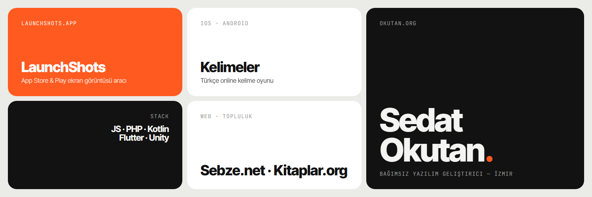

  

### Merhaba, ben Sedat 👋

İzmir'de bağımsız yazılım geliştiriciyim. Web platformları, topluluk siteleri, geliştirici araçları ve mobil oyunlar geliştiriyorum. Fikirden yayına kadar her aşamayı kendim yürütüyorum.

*Independent software developer from İzmir, Türkiye. I build web platforms, online communities, developer tools and mobile games — end to end.*

### 🚀 Yayında

| Proje | Ne? | Teknoloji |
|---|---|---|
| [**LaunchShots**](https://launchshots.app/) | App Store & Google Play için ücretsiz ekran görüntüsü tasarım aracı: 11 cihaz çerçevesi, 25 dil, üyelik yok, filigran yok | JavaScript · Canvas |
| [**Kelimeler**](https://okutan.org/kelimeler/) | Türkçe online kelime oyunu: [App Store](https://apps.apple.com/us/app/kelimeler-online-kelime-oyunu/id6775899635) · [Android](https://okutan.org/kelimeler/android.html) | Mobil |
| [**Sebze.net**](https://www.sebze.net/) | Hobi bahçeciliği ve sebze yetiştirme topluluğu | PHP · XenForo |
| [**Kitaplar.org**](https://www.kitaplar.org/) | Kitap keşfi, öneriler ve okur topluluğu | PHP |

### 🛠 Kullandıklarım

**Web:** JavaScript · PHP · XenForo · HTML/CSS · Canvas API · MySQL
**Mobil & Oyun:** Kotlin · Flutter · Unity · LibGDX

### 📫 İletişim

[okutan.org](https://okutan.org) · [sedat@okutan.org](mailto:sedat@okutan.org) · [X @okutanapp](https://x.com/okutanapp) · [App Store](https://apps.apple.com/us/developer/id6775899637)
